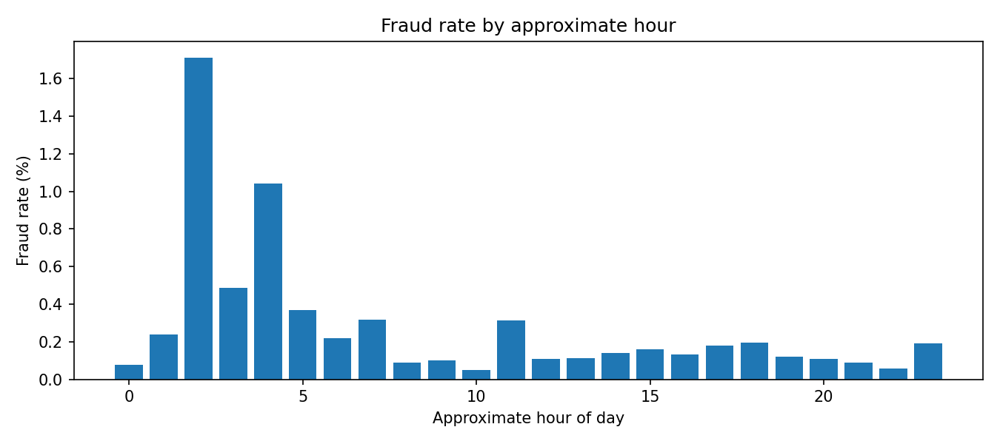
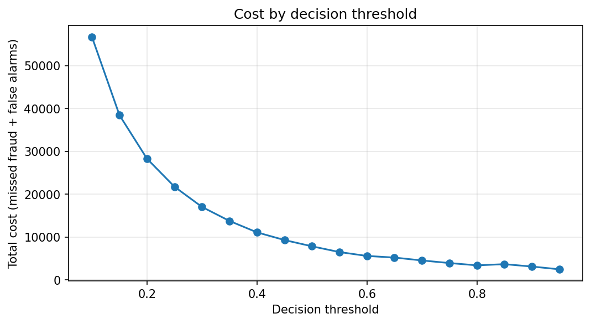
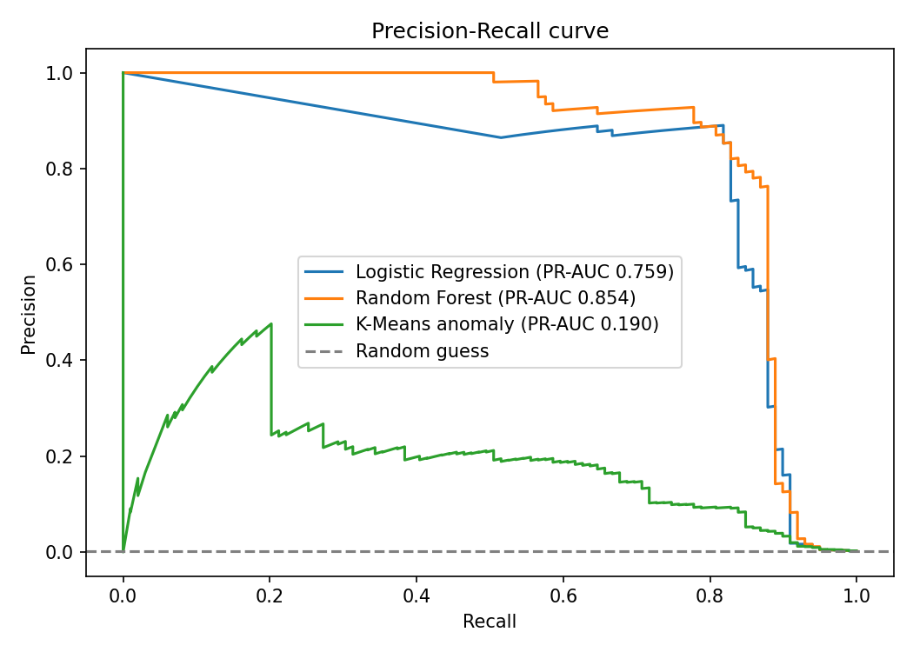
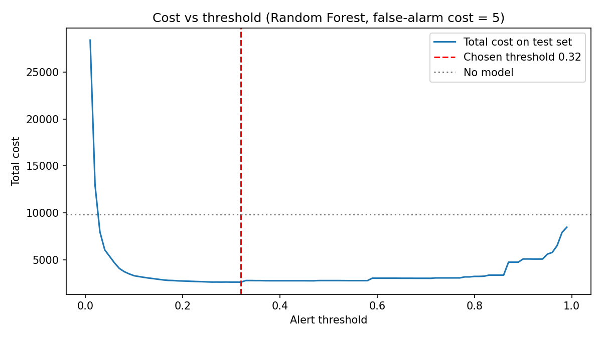

# Credit Card Fraud Detection: Analysis and Business Impact

Fraud is rare, so a model that says "everything is fine" is 99.83% accurate and still useless. This project explores the data, compares three approaches (class-weighted logistic regression, random forest, K-Means anomaly detector) using precision, recall and PR-AUC, and answers a business question: **where should the blocking threshold be set so that total losses are lowest?**

**Headline results** (held-out test sets, estimated using an *assumed* false-alarm cost):
- Random Forest: PR-AUC **0.854**, precision **0.870**, recall **0.808**, against precision 0.062 for logistic regression at the same 0.5 cut-off.
- With the threshold chosen on a separate validation set, estimated fraud losses fell by **73.3%** versus blocking nothing (false-alarm cost 5), and by **59% to 73%** across false-alarm costs from 1 to 100.

## Dataset
- Kaggle "Credit Card Fraud Detection" dataset (`creditcard.csv`): 284,807 transactions, 31 columns, from European cardholders over two days.
- Features: `Time`, `V1`-`V28` (anonymised PCA components), `Amount`; target is `Class` (1 = fraud).
- 492 frauds, which is **0.173%** of transactions. No missing values; 1,081 duplicate rows (not removed).
- The data file is not in this repo. Download it from Kaggle and place it next to the notebooks.

## Exploratory findings
- **Fraud by hour.** I derived `hour = (Time // 3600) % 24`. The overall fraud rate is 0.173%, but it reaches **1.713% at hour 2** and 1.041% at hour 4, while the lowest rate seen is 0.048% (hour 10). `Time` is seconds since the first transaction, not clock time, and each hour has few frauds, so treat this as a pattern worth checking, not a rule.
- **Fraud by amount.** Fraud transactions have a lower median amount (9.25 vs 22.00) but a higher mean (122.21 vs 88.29). The largest fraud is 2,125.87. The fraud rate is highest in the 500+ band (0.383%) and lowest in the 10-50 band (0.063%).

## Part 1: class-weighted logistic regression (`analysis_and_business_impact.ipynb`)
Stratified 80/20 split (`random_state=42`). The test set has 56,962 transactions, of which 98 are fraud.

| Metric (fraud class, 0.5 threshold) | Value |
|---|---|
| Recall | 0.918 (90 of 98 frauds caught) |
| Precision | 0.059 (1,439 false alarms) |
| F1 | 0.111 |
| ROC-AUC | 0.9714 |
| PR-AUC | 0.7199 |

The model catches most fraud at 0.5, but precision is very low, which is why the threshold matters.

**Does class weighting help?** Compared with the same pipeline without class weights: ROC-AUC 0.9720 vs 0.9527, but PR-AUC 0.7194 vs 0.7419. There is no clear winner on ranking quality, and with 98 test frauds the gap may be noise.

**Cost-based threshold.** A false alarm costs a fixed number of units and a missed fraud costs the transaction amount (**my assumptions, not from the dataset**). The threshold was chosen on a validation set and the cost measured once on the untouched test set. Fraud value in the test set if nothing is blocked: **10,644.9**.

| False-alarm cost | Threshold (from validation) | Frauds caught (of 98) | False alarms | Test cost | Reduction vs blocking nothing |
|---|---|---|---|---|---|
| 1 | 0.61 | 88 | 975 | 2,166.4 | 79.6% |
| 5 | 0.99 | 84 | 66 | 2,161.7 | 79.7% |
| 10 | 0.99 | 84 | 66 | 2,491.7 | 76.6% |
| 20 | 0.99 | 84 | 66 | 3,151.7 | 70.4% |

First-pass chart (thresholds swept directly on the test set, false-alarm cost 5, so it is optimistic):

## Part 2: model comparison (`model_comparison.ipynb`)
Stratified 60/20/20 train / validation / test split (`random_state=42`), so numbers differ slightly from Part 1. The test set has 56,962 transactions with 99 frauds. Logistic Regression and Random Forest use class weights. The K-Means detector is fitted on legitimate transactions only (8 clusters) and flags a transaction when its distance to the nearest cluster centre is above the 99th percentile of normal training data.

| Model (test set, 0.5 cut-off for LR and RF) | Precision | Recall | F1 | ROC-AUC | PR-AUC | Flagged |
|---|---|---|---|---|---|---|
| Logistic Regression | 0.062 | 0.909 | 0.116 | 0.968 | 0.759 | 1,459 |
| Random Forest | 0.870 | 0.808 | 0.838 | 0.970 | 0.854 | 92 |
| K-Means anomaly | 0.112 | 0.717 | 0.194 | 0.968 | 0.190 | 633 |

Random Forest ranks fraud best (highest PR-AUC) and produces far fewer false alarms. ROC-AUC looks similar for all three, which is why PR-AUC and precision matter more on data this imbalanced. K-Means has no labels at training time, so lower precision is expected.

### Cost-based threshold and sensitivity (Random Forest)
Threshold chosen on the validation set, results on the test set. Loss with no model: **9,874.4**.

| Strategy (false-alarm cost 5) | Missed frauds | False alarms | Total cost |
|---|---|---|---|
| No fraud model | 99 | 0 | 9,874.4 |
| Model at 0.5 threshold | 19 | 12 | 2,803.0 |
| Model at tuned threshold (0.32) | 16 | 20 | 2,636.2 |

| False-alarm cost | Best threshold | Missed frauds | False alarms | Total cost | Saving vs no model |
|---|---|---|---|---|---|
| 1 | 0.03 | 8 | 1,211 | 3,144.9 | 68.2% |
| 5 | 0.32 | 16 | 20 | 2,636.2 | 73.3% |
| 10 | 0.32 | 16 | 20 | 2,736.2 | 72.3% |
| 25 | 0.45 | 18 | 13 | 3,043.1 | 69.2% |
| 50 | 0.45 | 18 | 13 | 3,368.1 | 65.9% |
| 100 | 0.45 | 18 | 13 | 4,018.1 | 59.3% |

As false alarms get more expensive, the best threshold rises and the model flags fewer transactions. The saving stays above 59% in every case tested.

## Limitations
- Only 98-99 frauds in each test set, so results are noisy; one random split was used and no cross-validation.
- The false-alarm cost is an assumption; the tables show how the answer moves if it is wrong. The cost model also assumes a flagged fraud is fully stopped and a missed fraud loses its full amount.
- In Part 1, the best threshold for costs of 5 and above is 0.99, the top of the range searched.
- The validation set has only about 98 frauds, so the chosen thresholds could shift with a different split.
- `V1`-`V28` are anonymised PCA features, so results cannot be explained in business terms.
- The data covers two days from 2013 in Europe; patterns may not carry over to other markets or later years.
- The 1,081 duplicate rows were not removed.

## Earlier experiments and credits
The folder `earlier_experiments/` holds three older notebooks (`k-means.ipynb`, `logistic-regression.ipynb`, `neural-network.ipynb`). They are kept for reference only. They use older accuracy-based evaluation, are not part of the results above, and their neural-network and K-Means results are weak. They follow the structure of a 2017 Kaggle course project by Georgy Marrero, Makena Schwinn and Sunny Zhang: [link to original project, if known]. [Add one sentence saying exactly what you changed or wrote yourself.]

## Repository contents
- `analysis_and_business_impact.ipynb`: EDA, class-weighted logistic regression, validated cost-based threshold analysis
- `model_comparison.ipynb`: Logistic Regression vs Random Forest vs K-Means, PR curve, cost and sensitivity analysis
- `earlier_experiments/`: older notebooks, for reference
- `*.png`: charts used in this README
- `requirements.txt`: Python packages needed

## How to run
1. `pip install -r requirements.txt`
2. Download `creditcard.csv` from Kaggle and put it in the same folder as the notebooks.
3. Open `analysis_and_business_impact.ipynb` or `model_comparison.ipynb` and choose Run All. Random Forest takes a few minutes.

Tools: Python 3.10, pandas, numpy, scikit-learn, matplotlib.

## Author
Swati Pandita | [LinkedIn URL] | [email]
