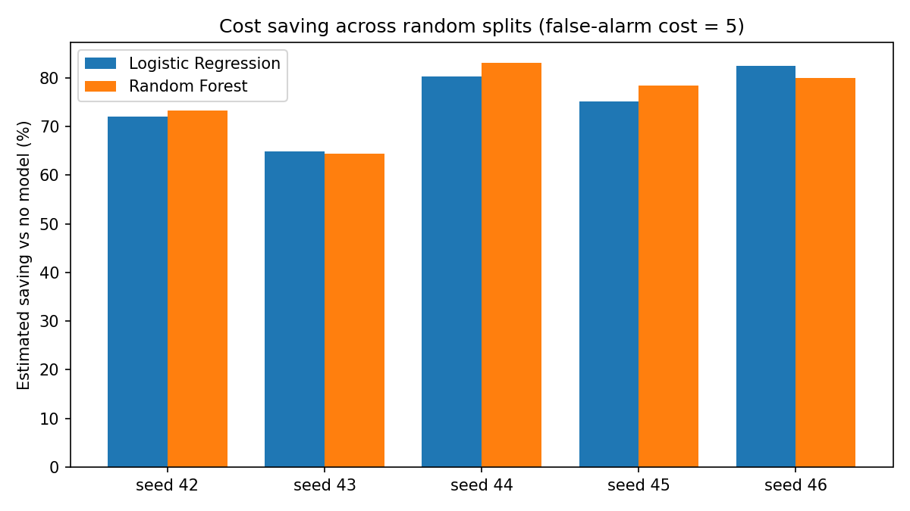
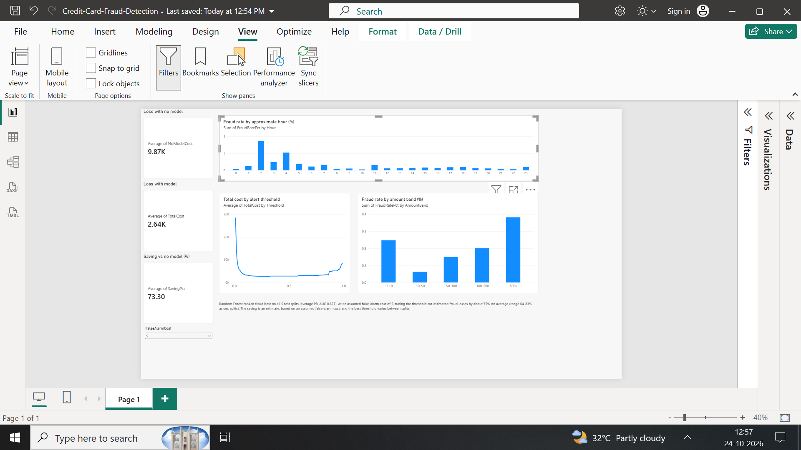

# Credit Card Fraud Detection: Analysis and Business Impact

Fraud is rare, so a model that says "everything is fine" is 99.83% accurate and still useless. This project explores the data, compares three approaches (class-weighted logistic regression, random forest, K-Means anomaly detector) using precision, recall and PR-AUC, and answers a business question: **where should the blocking threshold be set so that total losses are lowest?**

**Headline results** (held-out test sets, estimated using an *assumed* false-alarm cost, repeated over 5 random splits):
- Random Forest ranked fraud better than logistic regression on every split: PR-AUC averaged **0.827** (range 0.787-0.854) vs **0.728**, and precision at the 0.5 cut-off averaged **0.851** vs **0.064**.
- With the threshold chosen on a separate validation set, both models cut estimated fraud losses by about **75% on average versus blocking nothing** (range 64-83% across the 5 splits; false-alarm cost 5). After threshold tuning, neither model was clearly better on money saved.

## Dataset
- Kaggle "Credit Card Fraud Detection" dataset (`creditcard.csv`): 284,807 transactions, 31 columns, from European cardholders over two days.
- Features: `Time`, `V1`-`V28` (anonymised PCA components), `Amount`; target is `Class` (1 = fraud).
- 492 frauds, which is **0.173%** of transactions. No missing values; 1,081 duplicate rows (not removed).
- The data file is not in this repo. Download it from Kaggle and place it next to the notebooks.

## Exploratory findings
- **Fraud by hour.** I derived `hour = (Time // 3600) % 24`. The overall fraud rate is 0.173%, but it reaches **1.713% at hour 2** and 1.041% at hour 4, while the lowest rate seen is 0.048% (hour 10). `Time` is seconds since the first transaction, not clock time, and each hour has few frauds, so treat this as a pattern worth checking, not a rule.
- **Fraud by amount.** Fraud transactions have a lower median amount (9.25 vs 22.00) but a higher mean (122.21 vs 88.29). The largest fraud is 2,125.87. The fraud rate is highest in the 500+ band (0.383%) and lowest in the 10-50 band (0.063%).

## Part 1: class-weighted logistic regression (`analysis_and_business_impact.ipynb`)
Stratified 80/20 split (`random_state=42`). The test set has 56,962 transactions, of which 98 are fraud.

| Metric (fraud class, 0.5 threshold) | Value |
|---|---|
| Recall | 0.918 (90 of 98 frauds caught) |
| Precision | 0.059 (1,439 false alarms) |
| F1 | 0.111 |
| ROC-AUC | 0.9714 |
| PR-AUC | 0.7199 |

The model catches most fraud at 0.5, but precision is very low, which is why the threshold matters.

**Does class weighting help?** Compared with the same pipeline without class weights: ROC-AUC 0.9720 vs 0.9527, but PR-AUC 0.7194 vs 0.7419. There is no clear winner on ranking quality, and with 98 test frauds the gap may be noise.

**Cost-based threshold.** A false alarm costs a fixed number of units and a missed fraud costs the transaction amount (**my assumptions, not from the dataset**). The threshold was chosen on a validation set and the cost measured once on the untouched test set. Fraud value in the test set if nothing is blocked: **10,644.9**.

| False-alarm cost | Threshold (from validation) | Frauds caught (of 98) | False alarms | Test cost | Reduction vs blocking nothing |
|---|---|---|---|---|---|
| 1 | 0.61 | 88 | 975 | 2,166.4 | 79.6% |
| 5 | 0.99 | 84 | 66 | 2,161.7 | 79.7% |
| 10 | 0.99 | 84 | 66 | 2,491.7 | 76.6% |
| 20 | 0.99 | 84 | 66 | 3,151.7 | 70.4% |

First-pass chart (thresholds swept directly on the test set, false-alarm cost 5, so it is optimistic):

## Part 2: model comparison (`model_comparison.ipynb`)
Stratified 60/20/20 train / validation / test split (`random_state=42`), so numbers differ slightly from Part 1. The test set has 56,962 transactions with 99 frauds. Logistic Regression and Random Forest use class weights. The K-Means detector is fitted on legitimate transactions only (8 clusters) and flags a transaction when its distance to the nearest cluster centre is above the 99th percentile of normal training data.

| Model (test set, 0.5 cut-off for LR and RF) | Precision | Recall | F1 | ROC-AUC | PR-AUC | Flagged |
|---|---|---|---|---|---|---|
| Logistic Regression | 0.062 | 0.909 | 0.116 | 0.968 | 0.759 | 1,459 |
| Random Forest | 0.870 | 0.808 | 0.838 | 0.970 | 0.854 | 92 |
| K-Means anomaly | 0.112 | 0.717 | 0.194 | 0.968 | 0.190 | 633 |

Random Forest ranks fraud best (highest PR-AUC) and produces far fewer false alarms. ROC-AUC looks similar for all three, which is why PR-AUC and precision matter more on data this imbalanced. K-Means has no labels at training time, so lower precision is expected.

### Cost-based threshold and sensitivity (Random Forest)
Threshold chosen on the validation set, results on the test set. Loss with no model: **9,874.4**.

| Strategy (false-alarm cost 5) | Missed frauds | False alarms | Total cost |
|---|---|---|---|
| No fraud model | 99 | 0 | 9,874.4 |
| Model at 0.5 threshold | 19 | 12 | 2,803.0 |
| Model at tuned threshold (0.32) | 16 | 20 | 2,636.2 |

| False-alarm cost | Best threshold | Missed frauds | False alarms | Total cost | Saving vs no model |
|---|---|---|---|---|---|
| 1 | 0.03 | 8 | 1,211 | 3,144.9 | 68.2% |
| 5 | 0.32 | 16 | 20 | 2,636.2 | 73.3% |
| 10 | 0.32 | 16 | 20 | 2,736.2 | 72.3% |
| 25 | 0.45 | 18 | 13 | 3,043.1 | 69.2% |
| 50 | 0.45 | 18 | 13 | 3,368.1 | 65.9% |
| 100 | 0.45 | 18 | 13 | 4,018.1 | 59.3% |

As false alarms get more expensive, the best threshold rises and the model flags fewer transactions. The saving stays above 59% in every case tested.

## Part 3: robustness check (`robustness_check.ipynb`)
The results above come from one random split with about 99 test frauds, so they could be luck. This notebook repeats the full experiment (60/20/20 split, threshold chosen on validation, results on test, false-alarm cost 5) on 5 different random seeds.

| Seed | Model | PR-AUC | Precision (0.5) | Recall (0.5) | Chosen threshold | Saving vs no model |
|---|---|---|---|---|---|---|
| 42 | Logistic Regression | 0.759 | 0.062 | 0.909 | 0.99 | 72.1% |
| 42 | Random Forest | 0.854 | 0.870 | 0.808 | 0.32 | 73.3% |
| 43 | Logistic Regression | 0.705 | 0.058 | 0.939 | 0.99 | 64.9% |
| 43 | Random Forest | 0.814 | 0.840 | 0.798 | 0.57 | 64.4% |
| 44 | Logistic Regression | 0.780 | 0.071 | 0.919 | 0.99 | 80.3% |
| 44 | Random Forest | 0.836 | 0.862 | 0.818 | 0.41 | 83.2% |
| 45 | Logistic Regression | 0.715 | 0.064 | 0.899 | 0.93 | 75.2% |
| 45 | Random Forest | 0.787 | 0.840 | 0.798 | 0.14 | 78.4% |
| 46 | Logistic Regression | 0.681 | 0.068 | 0.919 | 0.99 | 82.4% |
| 46 | Random Forest | 0.842 | 0.845 | 0.828 | 0.09 | 80.0% |

| Average over 5 splits (std in brackets) | PR-AUC | Precision (0.5) | Recall (0.5) | Saving vs no model |
|---|---|---|---|---|
| Logistic Regression | 0.728 (0.041) | 0.064 (0.005) | 0.917 (0.015) | 75.0% (7.0) |
| Random Forest | 0.827 (0.026) | 0.851 (0.013) | 0.810 (0.013) | 75.9% (7.3) |

What this shows:
- **Random Forest's advantage on ranking and precision is consistent.** It had the higher PR-AUC and far higher precision on all 5 splits.
- **Its advantage on money saved is not.** After the threshold is tuned, the savings are similar (75.9% vs 75.0% on average), and logistic regression saved more on 2 of the 5 splits. The saving itself ranged from 64% to 83% depending on the split.
- **The chosen threshold is unstable.** For Random Forest it ranged from 0.09 to 0.57 across splits; for logistic regression it was 0.93-0.99, at the top of the range searched.

**Duplicates removed.** One run (seed 42) after dropping duplicate rows, with 95 test frauds, gave Random Forest PR-AUC 0.849, precision 0.880, recall 0.768 and a saving of 74.6%. Logistic regression gave PR-AUC 0.731 and a saving of 78.2%. These are close to the runs with duplicates, so the duplicates do not appear to drive the conclusions.

## What this means for a business
- **Threshold choice matters at least as much as model choice.** On the same test set at the default 0.5 cut-off, logistic regression flagged 1,459 transactions and Random Forest flagged 92. After tuning, both saved roughly the same amount, so the real difference is the number of alerts analysts must review.
- **Do not trust a single threshold.** Because the best threshold moved a lot between splits, a real system should set it on more data (for example with cross-validation) and re-check it regularly.
- **The savings are estimates, not forecasts.** They depend on the assumed false-alarm cost and on the assumption that every flagged fraud is stopped.

## Power BI dashboard
An interactive dashboard (`Credit-Card-Fraud-Detection.pbix`) lets a non-technical user choose the false-alarm cost and see the validation-chosen threshold, the estimated loss, the saving and the cost curve. It uses the Random Forest results of the seed-42 split in `model_comparison.ipynb`, plus the fraud rate by hour and by amount band. The data files are `threshold_analysis.csv`, `fraud_by_hour.csv` and `fraud_by_amount_band.csv`.

## Limitations
- Each test set has only about 95-99 frauds, so results are noisy. Part 3 repeats the split 5 times, but this is not full cross-validation.
- The false-alarm cost is an assumption; the tables show how the answer moves if it is wrong. The cost model also assumes a flagged fraud is fully stopped and a missed fraud loses its full amount.
- In Part 1, the best threshold for costs of 5 and above is 0.99, the top of the range searched.
- The validation set has only about 98 frauds, and Part 3 shows the chosen threshold does shift between splits.
- `V1`-`V28` are anonymised PCA features, so results cannot be explained in business terms.
- The data covers two days from 2013 in Europe; patterns may not carry over to other markets or later years.
- The 1,081 duplicate rows were not removed in the main results; Part 3 repeats one run without them and the conclusions look similar.

## Earlier experiments and credits
Three older notebooks (`k-means.ipynb`, `logistic-regression.ipynb`, `neural-network.ipynb`) are kept for reference only. They use older accuracy-based evaluation, are not part of the results above, and their neural-network and K-Means results are weak. They follow the structure of a 2017 Kaggle course project by Georgy Marrero, Makena Schwinn and Sunny Zhang.

## Repository contents
- `analysis_and_business_impact.ipynb`: EDA, class-weighted logistic regression, validated cost-based threshold analysis
- `model_comparison.ipynb`: Logistic Regression vs Random Forest vs K-Means, PR curve, cost and sensitivity analysis
- `robustness_check.ipynb`: repeats the experiment on 5 random splits and with duplicates removed
- `k-means.ipynb`, `logistic-regression.ipynb`, `neural-network.ipynb`: older notebooks, kept for reference
- `*.png`: charts used in this README
- `requirements.txt`: Python packages needed
- - `Credit-Card-Fraud-Detection.pbix`: interactive Power BI dashboard, with its 3 CSV data files

## How to run
1. `pip install -r requirements.txt`
2. Download `creditcard.csv` from Kaggle and put it in the same folder as the notebooks.
3. Open `analysis_and_business_impact.ipynb`, `model_comparison.ipynb` or `robustness_check.ipynb` and choose Run All. Random Forest takes a few minutes; `robustness_check.ipynb` takes about 10 minutes.

Tools: Python 3.10, pandas, numpy, scikit-learn, matplotlib.

## Author
Swati Pandita
